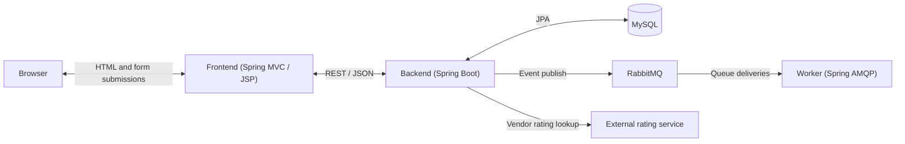

# SupplyChain architecture

The frontend serves the browser UI and calls the backend over HTTP. The backend owns business rules and MySQL persistence. RabbitMQ carries asynchronous events to the worker, whose current handlers simulate notifications rather than sending them.

## Components and ownership

| Component | Responsibility | Build and runtime |
| --- | --- | --- |
| Frontend | Renders server-side JSP pages. Its `RestTemplate` client handles calls to the backend rather than calling MySQL or RabbitMQ. | [Maven WAR][frontend-pom] deployed to [Tomcat][frontend-docker]. |
| Backend | Exposes REST APIs for orders, inventory, and vendors. Owns validation, status transitions, persistence, and event publication. | [Spring Boot REST/JPA][backend-pom], packaged as an [executable JAR][backend-docker]. |
| Worker | Consumes RabbitMQ messages independently of browser requests. Handlers log receipt, simulate processing, and log completion. | [Spring Boot AMQP][worker-pom], packaged as an [executable JAR][worker-docker]. |

All three projects target Java 8 and Spring Boot 2.7.18. MySQL stores [purchase orders][order-model], [inventory][inventory-model], and [vendors][vendor-model]. The backend uses Hibernate `ddl-auto: update`. The vendor rating path makes an [external HTTP call][vendor-rating] and returns `0` on failure.

## Async contracts

The backend [declares three durable RabbitMQ queues and a Jackson JSON converter][queues]. The worker's [listeners][listeners] use the corresponding queue names.

| Queue | Producer in the reviewed code | Worker behavior |
| --- | --- | --- |
| `order.created` | Order creation attempts to publish after saving the order. | Simulates order-created notification processing. |
| `inventory.alert` | The backend has an alert-publishing method, but no caller or scheduler was found. | Simulates low-stock notification processing. |
| `approval.pending` | No publisher was found. | Simulates an approval notification. |

The [order service][order-service] catches publish failures without failing order creation. A successful order response therefore does not prove that an event was delivered. The database write and queue publish are not atomic. JSON-to-listener conversion and broker delivery behavior were not verified at runtime.

## Scope

This is a source-code snapshot, not a description of a verified deployment. Source links pin the reviewed revisions: backend `a21f57e8`, frontend `c613adbc`, and worker `458f2bab`. See [typical workflows](workflow.md) for request paths, incomplete features, and a local smoke-check sequence.

[frontend-pom]: https://github.com/luxu-ms/SupplyChain-Frontend/blob/c613adbc961e0499d8f2ddb3e087ade7a9a40881/pom.xml#L8-L55
[frontend-docker]: https://github.com/luxu-ms/SupplyChain-Frontend/blob/c613adbc961e0499d8f2ddb3e087ade7a9a40881/Dockerfile#L2-L22
[backend-pom]: https://github.com/luxu-ms/SupplyChain-Backend/blob/a21f57e84901bad3cf315de2a3520fa8fe34b911/pom.xml#L8-L54
[backend-docker]: https://github.com/luxu-ms/SupplyChain-Backend/blob/a21f57e84901bad3cf315de2a3520fa8fe34b911/Dockerfile#L6-L24
[worker-pom]: https://github.com/luxu-ms/SupplyChain-Worker/blob/458f2bab94b08b3acd167feb04fc485a7ecf6133/pom.xml#L8-L40
[worker-docker]: https://github.com/luxu-ms/SupplyChain-Worker/blob/458f2bab94b08b3acd167feb04fc485a7ecf6133/Dockerfile#L2-L18
[order-model]: https://github.com/luxu-ms/SupplyChain-Backend/blob/a21f57e84901bad3cf315de2a3520fa8fe34b911/src/main/java/com/acme/scm/model/PurchaseOrder.java#L14-L33
[inventory-model]: https://github.com/luxu-ms/SupplyChain-Backend/blob/a21f57e84901bad3cf315de2a3520fa8fe34b911/src/main/java/com/acme/scm/model/Inventory.java#L13-L34
[vendor-model]: https://github.com/luxu-ms/SupplyChain-Backend/blob/a21f57e84901bad3cf315de2a3520fa8fe34b911/src/main/java/com/acme/scm/model/Vendor.java#L14-L25
[vendor-rating]: https://github.com/luxu-ms/SupplyChain-Backend/blob/a21f57e84901bad3cf315de2a3520fa8fe34b911/src/main/java/com/acme/scm/service/VendorService.java#L46-L58
[queues]: https://github.com/luxu-ms/SupplyChain-Backend/blob/a21f57e84901bad3cf315de2a3520fa8fe34b911/src/main/java/com/acme/scm/config/AppConfig.java#L43-L67
[listeners]: https://github.com/luxu-ms/SupplyChain-Worker/blob/458f2bab94b08b3acd167feb04fc485a7ecf6133/src/main/java/com/acme/scm/worker/listener/OrderMessageListener.java#L16-L56
[order-service]: https://github.com/luxu-ms/SupplyChain-Backend/blob/a21f57e84901bad3cf315de2a3520fa8fe34b911/src/main/java/com/acme/scm/service/PurchaseOrderService.java#L36-L61
