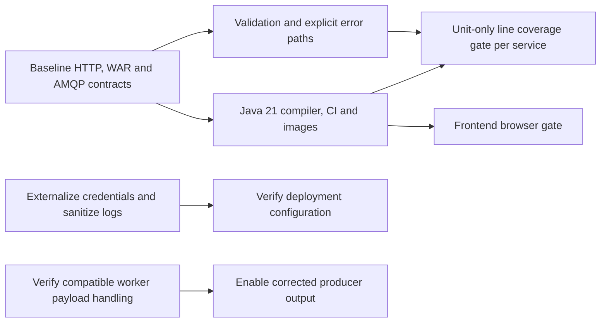

# SupplyChain guideline alignment: gaps and proposed changes

## Executive summary

The main gaps are shared across the three Java applications: their checked-in builds and images use Java 8 rather than Java 21+, and none of the reviewed application trees contains a checked-in test suite or CI workflow demonstrating the required 75% unit-only line coverage.[^java][^tests][^bpom][^fpom][^wpom][^trees] The frontend also lacks the required merge-blocking browser suite.[^browser][^trees] At code level, prioritize removing checked-in credentials and unsafe logging, then address field injection, boundary validation, loss of monetary precision, and failure paths that look like success.[^code][^backend-config][^worker-config][^create][^dashboard][^listener] Keep RabbitMQ and the WAR/JSP UI unless there is a separate reason to change them; the guideline requires a compatible toolchain and observable behavior, not a rewrite.[^java][^code][^browser]

## Scope and reviewed repositories

This is a technical gap analysis and proposed migration plan, not a code change. The guideline describes requirements for future changes, while the architecture documents the older implementation snapshot.[^java][^snapshot]

| Repository | Reviewed revision | Role in the assessment |
| --- | --- | --- |
| [luxu-ms/SupplyChain-Docs](https://github.com/luxu-ms/SupplyChain-Docs) | `0a26dc4547021e0fb6283a1a467e7fe0101dcc79` | Policy and operational baseline.[^java][^code][^tests][^browser] |
| [luxu-ms/SupplyChain-Backend](https://github.com/luxu-ms/SupplyChain-Backend) | `a21f57e84901bad3cf315de2a3520fa8fe34b911` | REST validation, persistence and event publication.[^order-api][^create][^queues] |
| [luxu-ms/SupplyChain-Frontend](https://github.com/luxu-ms/SupplyChain-Frontend) | `c613adbc961e0499d8f2ddb3e087ade7a9a40881` | MVC, JSP/WAR, browser journeys.[^fpom][^frontend-orders][^form] |
| [luxu-ms/SupplyChain-Worker](https://github.com/luxu-ms/SupplyChain-Worker) | `458f2bab94b08b3acd167feb04fc485a7ecf6133` | AMQP listener and processing boundaries.[^wpom][^listener] |

## Requirements and proposed acceptance

| Guideline | Proposed change and acceptance |
| --- | --- |
| Java 21+, Maven compiler `release`, matching environments | Replace Java 8 source/target with compiler `release` 21 or the chosen higher version. Align developer builds, PR CI, Docker build stages and runtimes. Verify JAR startup for backend and worker, and WAR deployment plus JSP rendering in the actual external Tomcat image.[^java][^bpom][^fpom][^wpom][^bimage][^fimage][^wimage] |
| Java conventions and layering | Use an agreed formatter, explicit imports, prescribed naming, typed collections and constructor injection. Prefer immutable request/event data where appropriate. Put rules in focused services, avoid duplicated rules and use configuration for deployment values. Introduce formatting checks with a small, separate mechanical change rather than mixing cleanup with behavior changes.[^code][^order-api][^frontend-orders][^listener] |
| Boundary validation and honest failures | Validate form and API inputs before business work, catch only failures that can be handled, preserve causes, and keep secrets and personal data out of parameterized logs. Distinguish genuine zero or empty results from upstream failure. Keep money in `BigDecimal`; agree and test scale and rounding where applicable.[^code][^create][^rating][^dashboard][^listener] |
| Secret and resource handling | Remove literal datasource/broker credentials from tracked config, source deployment values from approved secret storage, and check whether any deployed copies require rotation. Review parameterized persistence and resource ownership when touching those areas; the guideline alone does not establish a violation there.[^code][^backend-config][^worker-config] |
| Unit-test gate | Require at least **75% production-code line coverage from JUnit 5 unit tests per Java project**. Fail CI below threshold or when no unit tests or coverage results are produced. Keep JaCoCo unit data and reports separate from integration and browser runs; do not hide business logic in exclusions.[^tests][^trees] |
| Browser-test gate | Add required PR CI for the frontend. Cover dashboard, valid order submission, validation feedback, appearance in pending orders, and working inventory browsing. Add browser approval cases when the frontend action exists. Retain failure traces or screenshots; use isolated fixtures, stable selectors, and condition-based waits.[^browser][^form][^pending][^inventory-ui][^frontend-orders] |

## Component changes

### Backend: make write inputs narrow and errors explicit

Replace field injection and wildcard imports in the order layer. Give `POST /api/orders` a validated create-request DTO instead of accepting the persistence entity directly: accept the user-entered fields, and own initial status, approval fields and lifecycle dates on the server. Keep the active-vendor check in the service and test null, zero, negative, over-scale and accepted amounts plus vendor rejection. Return controlled validation failures. The current monetary check (`order.getTotalAmount().doubleValue() <= 0`) narrows a `BigDecimal`; use null validation and `signum()` or `compareTo(BigDecimal.ZERO)` instead, with an explicit scale/rounding policy for the database's two-place amount.[^code][^order-api][^create][^money]

Move the rating-service host and timeout settings into configuration, and use an injected client. Replace blanket catch-and-`0.0` with an explicit failure path; a legitimate zero should remain distinguishable from unavailability. Agree the error contract before changing clients. The guideline does not prescribe a particular service-mesh SDK.[^code][^rating][^rating-api]

Regression cases: validate create before save/send, verify the allowed `PENDING` approval transition and rejected transitions, and exercise stock below, at and above the safety-stock threshold.[^tests][^create][^approve][^stock][^inventory]

### Frontend: preserve JSP behavior, improve validation and errors

Keep the server-rendered WAR and existing navigation as the baseline. Convert field injection to constructors, move dashboard aggregation out of the controller, and inject a clock for deterministic date tests. Replace the all-zero fallback with an explicit unavailable state. Validate submission server-side, redisplay actionable errors and preserve submitted fields, including the selected vendor. Cover success redirects and failure models in unit tests. Extracting shared styles or replacing hardcoded vendor options can improve maintainability, but the guideline does not require a CSS overhaul or dynamic vendor options.[^code][^frontend-orders][^dashboard][^form][^fpom]

For browser PR tests, run the actual frontend against an isolated, stateful HTTP fake of the backend (browser-side request interception alone does not catch server-side `RestTemplate` calls). Use distinctive nonzero dashboard fixtures, a unique order number, a vendor fixture matching IDs 1–4, and accessible labels or unique rows. Check required-field validation and a server-rejected submission, such as zero amount against the current form; assert a visible error and no created order. Verify the order appears in both list and pending, and inventory displays low-stock and normal rows. Retain a separate smoke check with a real backend and database; the fake does not prove persistence or runtime delivery.[^browser][^frontend-client][^dashboard][^form][^frontend-orders][^pending][^inventory-ui][^create][^smoke]

The current Approve link sends a frontend GET with no matching handler, whereas the backend requires `PUT` with `approvedBy`. Do not treat API approval as passing a browser approval requirement. If enabling the feature, add a state-changing UI action, visible success/failure behavior and approval browser cases; otherwise document the unavailable action.[^browser][^pending][^frontend-orders][^order-api][^approve]

### Worker and producer: separate policy gaps from delivery redesign

The worker logs full message bodies and catches broad exceptions before returning normally. Replace raw-body logging with safe, parameterized metadata; validate messages at entry and delegate processing to a constructor-injected service. Agree how invalid, transient and unexpected failures surface. Keep tests deterministic with stubbed processing rather than real delays. Current handlers simulate dispatch; actual notification delivery, retry/dead-letter choices and broker acknowledgment behavior are separate product/operational decisions.[^code][^tests][^listener][^worker-config]

Prioritize an AMQP regression independently of a broker redesign. The producer installs `new Jackson2JsonMessageConverter()` and sends entities with Java-time fields; the reviewed converter constructs a plain mapper, so timestamp serialization is expected to fail. Use a Java-time-capable mapper and verify a representative serialized saved order can be read by the worker. The save and publish are not atomic and publishing exceptions are caught; a mapper fix alone does not guarantee delivery. Make the delivery contract explicit. A transactional outbox and retry/dead-letter policy are options if delivery guarantees warrant them, not named guideline requirements.[^queues][^converter][^timestamps][^create][^listener][^code]

## Rollout and gates

1. **Address credential and logging gaps early.** Confirm approved secret storage, log policy and deployed configuration ownership. Capture current HTTP, JSON and WAR behavior before larger changes.[^code][^backend-config][^worker-config][^listener][^snapshot]
2. **Align Java and prove compatibility.** Spring Boot 2.7.18 documents Java 21 compatibility, making JDK-first a possible bridge, not proof of app compatibility or ongoing maintenance. Check maintenance and patch entitlement separately. If retaining `javax`, verify a compatible external Tomcat/JSP/JSTL combination; if adopting a supported Boot 3 release, plan Jakarta migration for JPA and the servlet/JSTL stack and verify the WAR in its matching container. No guideline clause mandates Boot 3, replacing JSP, or changing broker.[^java][^boot-compat][^boot-support][^fpom][^fimage][^jpa][^boot3-compat]
3. **Enforce gates as suites become credible.** Run unit tests with JaCoCo before separate integration and browser suites; expose reports, make checks required for merge and verify threshold enforcement by observing a failing below-threshold run. Start with behavior-focused tests and add regressions with fixes. Require frontend browser checks once they cover the available critical journeys.[^tests][^browser][^trees]
4. **Roll out behavior changes with explicit contracts.** Land boundary and failure changes with regressions. Keep HTTP and event shapes stable where practical; if worker input changes, verify backward compatibility and deploy a compatible consumer before enabling the changed producer. Verify saved orders and worker receipt separately.[^code][^tests][^listener][^create][^smoke]

## Confidence assessment

**High for source findings and policy interpretation.** The three application heads matched the earlier snapshots when reviewed. The docs lexical index reported `c12fb6bab374e5042372ecdda94cbd5892b12431`; the guideline used here was read directly at `0a26dc4547021e0fb6283a1a467e7fe0101dcc79`. Full application trees and POMs support the checked-in testing gap; that is not a measured coverage result or proof that external gates do not exist.[^snapshot][^java][^trees][^bpom][^fpom][^wpom]

**Unverified at runtime:** Java 21 startup, external Tomcat and JSP compatibility, broker behavior, secret-store choices, GitHub rulesets and external CI. The sequencing, technology selections and proposed failure contracts are recommendations, not prescribed by the guideline. No repositories were modified by this analysis.[^java][^code][^tests][^browser][^smoke]

## Footnotes

[^java]: [SupplyChain-Docs/guideline.md:1-7](https://github.com/luxu-ms/SupplyChain-Docs/blob/0a26dc4547021e0fb6283a1a467e7fe0101dcc79/guideline.md#L1-L7).
[^code]: [SupplyChain-Docs/guideline.md:11-18](https://github.com/luxu-ms/SupplyChain-Docs/blob/0a26dc4547021e0fb6283a1a467e7fe0101dcc79/guideline.md#L11-L18).
[^tests]: [SupplyChain-Docs/guideline.md:20-24](https://github.com/luxu-ms/SupplyChain-Docs/blob/0a26dc4547021e0fb6283a1a467e7fe0101dcc79/guideline.md#L20-L24).
[^browser]: [SupplyChain-Docs/guideline.md:26-30](https://github.com/luxu-ms/SupplyChain-Docs/blob/0a26dc4547021e0fb6283a1a467e7fe0101dcc79/guideline.md#L26-L30).
[^snapshot]: [SupplyChain-Docs/architecture.md:17-23](https://github.com/luxu-ms/SupplyChain-Docs/blob/0a26dc4547021e0fb6283a1a467e7fe0101dcc79/architecture.md#L17-L23), [39-41](https://github.com/luxu-ms/SupplyChain-Docs/blob/0a26dc4547021e0fb6283a1a467e7fe0101dcc79/architecture.md#L39-L41).
[^smoke]: [SupplyChain-Docs/workflow.md:26-33](https://github.com/luxu-ms/SupplyChain-Docs/blob/0a26dc4547021e0fb6283a1a467e7fe0101dcc79/workflow.md#L26-L33).
[^trees]: Complete tracked tree enumerations (absence has no line range): [backend](https://github.com/luxu-ms/SupplyChain-Backend/tree/a21f57e84901bad3cf315de2a3520fa8fe34b911), [frontend](https://github.com/luxu-ms/SupplyChain-Frontend/tree/c613adbc961e0499d8f2ddb3e087ade7a9a40881), [worker](https://github.com/luxu-ms/SupplyChain-Worker/tree/458f2bab94b08b3acd167feb04fc485a7ecf6133). See POM citations for test dependencies and build plugins.
[^bpom]: [SupplyChain-Backend/pom.xml:16-28](https://github.com/luxu-ms/SupplyChain-Backend/blob/a21f57e84901bad3cf315de2a3520fa8fe34b911/pom.xml#L16-L28), [69-92](https://github.com/luxu-ms/SupplyChain-Backend/blob/a21f57e84901bad3cf315de2a3520fa8fe34b911/pom.xml#L69-L92).
[^fpom]: [SupplyChain-Frontend/pom.xml:8-55](https://github.com/luxu-ms/SupplyChain-Frontend/blob/c613adbc961e0499d8f2ddb3e087ade7a9a40881/pom.xml#L8-L55), [64-87](https://github.com/luxu-ms/SupplyChain-Frontend/blob/c613adbc961e0499d8f2ddb3e087ade7a9a40881/pom.xml#L64-L87).
[^wpom]: [SupplyChain-Worker/pom.xml:16-28](https://github.com/luxu-ms/SupplyChain-Worker/blob/458f2bab94b08b3acd167feb04fc485a7ecf6133/pom.xml#L16-L28), [37-65](https://github.com/luxu-ms/SupplyChain-Worker/blob/458f2bab94b08b3acd167feb04fc485a7ecf6133/pom.xml#L37-L65).
[^bimage]: [SupplyChain-Backend/Dockerfile:6-16](https://github.com/luxu-ms/SupplyChain-Backend/blob/a21f57e84901bad3cf315de2a3520fa8fe34b911/Dockerfile#L6-L16).
[^fimage]: [SupplyChain-Frontend/Dockerfile:2-22](https://github.com/luxu-ms/SupplyChain-Frontend/blob/c613adbc961e0499d8f2ddb3e087ade7a9a40881/Dockerfile#L2-L22).
[^wimage]: [SupplyChain-Worker/Dockerfile:1-12](https://github.com/luxu-ms/SupplyChain-Worker/blob/458f2bab94b08b3acd167feb04fc485a7ecf6133/Dockerfile#L1-L12).
[^order-api]: [SupplyChain-Backend/src/main/java/com/acme/scm/controller/PurchaseOrderController.java:6-56](https://github.com/luxu-ms/SupplyChain-Backend/blob/a21f57e84901bad3cf315de2a3520fa8fe34b911/src/main/java/com/acme/scm/controller/PurchaseOrderController.java#L6-L56).
[^create]: [SupplyChain-Backend/src/main/java/com/acme/scm/service/PurchaseOrderService.java:36-61](https://github.com/luxu-ms/SupplyChain-Backend/blob/a21f57e84901bad3cf315de2a3520fa8fe34b911/src/main/java/com/acme/scm/service/PurchaseOrderService.java#L36-L61).
[^approve]: [SupplyChain-Backend/src/main/java/com/acme/scm/service/PurchaseOrderService.java:73-90](https://github.com/luxu-ms/SupplyChain-Backend/blob/a21f57e84901bad3cf315de2a3520fa8fe34b911/src/main/java/com/acme/scm/service/PurchaseOrderService.java#L73-L90).
[^money]: [SupplyChain-Backend/src/main/java/com/acme/scm/model/PurchaseOrder.java:25-29](https://github.com/luxu-ms/SupplyChain-Backend/blob/a21f57e84901bad3cf315de2a3520fa8fe34b911/src/main/java/com/acme/scm/model/PurchaseOrder.java#L25-L29).
[^timestamps]: [SupplyChain-Backend/src/main/java/com/acme/scm/model/PurchaseOrder.java:31-63](https://github.com/luxu-ms/SupplyChain-Backend/blob/a21f57e84901bad3cf315de2a3520fa8fe34b911/src/main/java/com/acme/scm/model/PurchaseOrder.java#L31-L63).
[^jpa]: [SupplyChain-Backend/src/main/java/com/acme/scm/model/PurchaseOrder.java:3-15](https://github.com/luxu-ms/SupplyChain-Backend/blob/a21f57e84901bad3cf315de2a3520fa8fe34b911/src/main/java/com/acme/scm/model/PurchaseOrder.java#L3-L15).
[^rating]: [SupplyChain-Backend/src/main/java/com/acme/scm/service/VendorService.java:36-58](https://github.com/luxu-ms/SupplyChain-Backend/blob/a21f57e84901bad3cf315de2a3520fa8fe34b911/src/main/java/com/acme/scm/service/VendorService.java#L36-L58).
[^rating-api]: [SupplyChain-Backend/src/main/java/com/acme/scm/controller/VendorController.java:32-36](https://github.com/luxu-ms/SupplyChain-Backend/blob/a21f57e84901bad3cf315de2a3520fa8fe34b911/src/main/java/com/acme/scm/controller/VendorController.java#L32-L36).
[^backend-config]: [SupplyChain-Backend/src/main/resources/application.yml:8-31](https://github.com/luxu-ms/SupplyChain-Backend/blob/a21f57e84901bad3cf315de2a3520fa8fe34b911/src/main/resources/application.yml#L8-L31).
[^queues]: [SupplyChain-Backend/src/main/java/com/acme/scm/config/AppConfig.java:43-67](https://github.com/luxu-ms/SupplyChain-Backend/blob/a21f57e84901bad3cf315de2a3520fa8fe34b911/src/main/java/com/acme/scm/config/AppConfig.java#L43-L67).
[^stock]: [SupplyChain-Backend/src/main/java/com/acme/scm/service/InventoryService.java:41-63](https://github.com/luxu-ms/SupplyChain-Backend/blob/a21f57e84901bad3cf315de2a3520fa8fe34b911/src/main/java/com/acme/scm/service/InventoryService.java#L41-L63).
[^inventory]: [SupplyChain-Backend/src/main/java/com/acme/scm/model/Inventory.java:48-50](https://github.com/luxu-ms/SupplyChain-Backend/blob/a21f57e84901bad3cf315de2a3520fa8fe34b911/src/main/java/com/acme/scm/model/Inventory.java#L48-L50).
[^worker-config]: [SupplyChain-Worker/src/main/resources/application.yml:8-21](https://github.com/luxu-ms/SupplyChain-Worker/blob/458f2bab94b08b3acd167feb04fc485a7ecf6133/src/main/resources/application.yml#L8-L21).
[^listener]: [SupplyChain-Worker/src/main/java/com/acme/scm/worker/listener/OrderMessageListener.java:16-56](https://github.com/luxu-ms/SupplyChain-Worker/blob/458f2bab94b08b3acd167feb04fc485a7ecf6133/src/main/java/com/acme/scm/worker/listener/OrderMessageListener.java#L16-L56).
[^frontend-orders]: [SupplyChain-Frontend/src/main/java/com/acme/scm/frontend/controller/OrderController.java:6-71](https://github.com/luxu-ms/SupplyChain-Frontend/blob/c613adbc961e0499d8f2ddb3e087ade7a9a40881/src/main/java/com/acme/scm/frontend/controller/OrderController.java#L6-L71).
[^frontend-client]: [SupplyChain-Frontend/src/main/java/com/acme/scm/frontend/service/BackendApiService.java:29-65](https://github.com/luxu-ms/SupplyChain-Frontend/blob/c613adbc961e0499d8f2ddb3e087ade7a9a40881/src/main/java/com/acme/scm/frontend/service/BackendApiService.java#L29-L65).
[^dashboard]: [SupplyChain-Frontend/src/main/java/com/acme/scm/frontend/controller/HomeController.java:21-62](https://github.com/luxu-ms/SupplyChain-Frontend/blob/c613adbc961e0499d8f2ddb3e087ade7a9a40881/src/main/java/com/acme/scm/frontend/controller/HomeController.java#L21-L62).
[^form]: [SupplyChain-Frontend/src/main/webapp/WEB-INF/jsp/orders/new.jsp:54-101](https://github.com/luxu-ms/SupplyChain-Frontend/blob/c613adbc961e0499d8f2ddb3e087ade7a9a40881/src/main/webapp/WEB-INF/jsp/orders/new.jsp#L54-L101).
[^pending]: [SupplyChain-Frontend/src/main/webapp/WEB-INF/jsp/orders/pending.jsp:60-85](https://github.com/luxu-ms/SupplyChain-Frontend/blob/c613adbc961e0499d8f2ddb3e087ade7a9a40881/src/main/webapp/WEB-INF/jsp/orders/pending.jsp#L60-L85).
[^inventory-ui]: [SupplyChain-Frontend/src/main/webapp/WEB-INF/jsp/inventory.jsp:48-95](https://github.com/luxu-ms/SupplyChain-Frontend/blob/c613adbc961e0499d8f2ddb3e087ade7a9a40881/src/main/webapp/WEB-INF/jsp/inventory.jsp#L48-L95).
[^converter]: [Spring AMQP v2.4.17/spring-amqp/src/main/java/org/springframework/amqp/support/converter/Jackson2JsonMessageConverter.java:45-80](https://github.com/spring-projects/spring-amqp/blob/v2.4.17/spring-amqp/src/main/java/org/springframework/amqp/support/converter/Jackson2JsonMessageConverter.java#L45-L80).
[^boot-compat]: [Spring Boot v2.7.18/spring-boot-project/spring-boot-docs/src/docs/asciidoc/getting-started/system-requirements.adoc:1-40](https://github.com/spring-projects/spring-boot/blob/v2.7.18/spring-boot-project/spring-boot-docs/src/docs/asciidoc/getting-started/system-requirements.adoc#L1-L40).
[^boot-support]: [Spring Support Updates, December 2024](https://spring.io/blog/2024/12/10/spring-support-updates/).
[^boot3-compat]: [Spring Boot v3.4.0/spring-boot-project/spring-boot-docs/src/docs/antora/modules/ROOT/pages/system-requirements.adoc:4-39](https://github.com/spring-projects/spring-boot/blob/v3.4.0/spring-boot-project/spring-boot-docs/src/docs/antora/modules/ROOT/pages/system-requirements.adoc#L4-L39), representative Boot 3 requirements, not a version recommendation.
