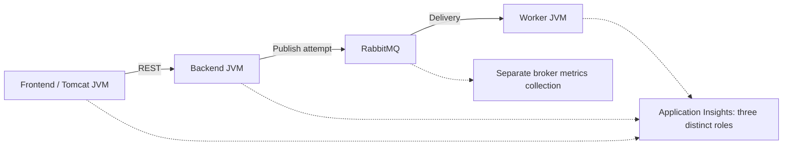

# SupplyChain guideline alignment — November 26, 2026

## Executive summary

The current guideline applies **Spring Boot 4.2.x on JDK 21 or 25** to backend, frontend, and worker, and calls for **Azure Application Insights** across all three. The November 25 gap analysis predates both updates, and the dependency report still describes Boot 4.2 as a new-project recommendation; neither is the current policy. The reviewed application heads remain on Boot 2.7.18/Java 8, with no checked-in telemetry integration or evidence of the required unit and browser CI gates. Prioritize safe telemetry and regression coverage, then migrate the runtimes while preserving HTTP and RabbitMQ contracts.[^policy][^insights][^earlier][^dependency-report][^backend-pom][^frontend-pom][^worker-pom][^trees][^quality]

## Repository baseline

| Repository | Verified `main` revision | Alignment concern |
| --- | --- | --- |
| [luxu-ms/SupplyChain-Docs](https://github.com/luxu-ms/SupplyChain-Docs) | `0d271dc6fd1c4dd882f66afaa749c03cd77ebb71` | Current guideline broadens the Boot requirement and adds monitoring. Cross-reference or revise older recommendations without rewriting their historical inventory.[^policy][^insights][^earlier][^dependency-report] |
| [luxu-ms/SupplyChain-Backend](https://github.com/luxu-ms/SupplyChain-Backend) | `a21f57e84901bad3cf315de2a3520fa8fe34b911` | Executable JAR, REST/JPA, MySQL, and RabbitMQ producer.[^backend-pom][^backend-image][^producer] |
| [luxu-ms/SupplyChain-Frontend](https://github.com/luxu-ms/SupplyChain-Frontend) | `c613adbc961e0499d8f2ddb3e087ade7a9a40881` | WAR/JSP under external Tomcat; server-side REST calls.[^frontend-pom][^frontend-image][^client] |
| [luxu-ms/SupplyChain-Worker](https://github.com/luxu-ms/SupplyChain-Worker) | `458f2bab94b08b3acd167feb04fc485a7ecf6133` | Executable JAR and RabbitMQ consumers that simulate notifications.[^worker-pom][^worker-image][^listener] |

## Runtime and framework changes

Choose one JDK baseline for the build, CI, compiler `release`, and runtime images; JDK 21 is a reasonable proposed first target and JDK 25 is also permitted. Adopt the Boot 4.2 parent or BOM and update direct dependencies intentionally. Boot 4.2.0 was the latest stable release verified for this review; the project's Java choices are narrower than Boot's own minimum. Treat Boot 3 and any intermediate Boot 4 migration checkpoints as engineering steps, not final compliance. Follow Spring's staged migration guides and review removed APIs, modular starters, and property changes.[^policy][^release][^requirements][^boot3][^boot4][^boot42]

| Component | Changes to make | Acceptance |
| --- | --- | --- |
| Backend | Migrate JPA imports to Jakarta; review Hibernate 7, the old explicit MySQL dialect, connector pin, and schema-update setting. Migrate directly constructed `RestTemplate` toward `RestClient` as appropriate. Preserve the order HTTP contract while introducing validated request DTOs and keeping money in `BigDecimal` rather than narrowing to `double`.[^jpa][^database][^backend-pom][^producer][^order-api][^code][^boot42] | Verify clean startup, schema compatibility, persistence and order status transitions against an isolated MySQL instance before rollout.[^database][^order-api][^producer] |
| Frontend | Replace the Java 8/Tomcat 8.5 image with a compatible Servlet 6.1+ runtime such as Tomcat 11; update provided Tomcat/Jasper and Jakarta-compatible JSTL, check JSP tags and WAR initialization, and verify the actual connector. No guideline requires replacing JSP.[^policy][^requirements][^frontend-pom][^frontend-image][^client] | Deploy the WAR to the intended image, render representative JSPs and run dashboard, ordering and inventory browser journeys.[^frontend-image][^quality] |
| Backend and worker | Boot 4.2 repurposes `spring-boot-starter-amqp` for AMQP 1.0. Use `spring-boot-starter-rabbitmq` to retain the current RabbitMQ AMQP 0-9-1 integration. Review the Jackson 3 transition and explicitly regression-test payload dates, headers, and old/new interoperability. The current no-arg converter is already expected to fail on persisted Java-time timestamps; a framework bump is not proof of a fix.[^boot42][^backend-pom][^worker-pom][^producer][^listener][^delivery] | Verify publication, routing, worker processing and recovery separately. If output changes, validate and deploy a backward-compatible consumer before enabling the new producer.[^producer][^listener][^delivery] |

## Application Insights implementation

Use a pinned Application Insights Java agent as the first candidate. It is Azure Monitor's Java OpenTelemetry autoinstrumentation option; a separate SDK integration is not necessary just to start instrumenting these JVMs. Microsoft documents Java 8+, but that does not certify the exact target Boot 4.2/JDK/Tomcat combination. Test the selected agent in both the legacy environment, if deploying it early, and the chosen target runtime. The three checked-in startup definitions do not attach an agent and their manifests do not declare telemetry libraries; platform-side configuration is still unknown.[^azure-start][^azure-spring][^backend-image][^frontend-image][^worker-image][^backend-pom][^frontend-pom][^worker-pom][^trees]

For backend and worker, attach `-javaagent:/opt/monitoring/applicationinsights-agent.jar` to the existing JAR JVM. For the frontend, attach it to **Tomcat's JVM**, not to `ROOT.war`; a mount plus deployment-injected `JAVA_TOOL_OPTIONS=-javaagent:/opt/monitoring/applicationinsights-agent.jar` is a candidate where the image cannot be changed. Inject `APPLICATIONINSIGHTS_CONNECTION_STRING` at deployment, set distinct `APPLICATIONINSIGHTS_ROLE_NAME` values for the three apps, and review sampling before interpreting trace counts. Do not log full worker message bodies or export secrets or personal data. If multiple applications share a Tomcat JVM, do not assume a JVM-level role setting separates their telemetry.[^azure-spring][^azure-server][^azure-config][^listener][^code]

This is the proposed telemetry topology, not a statement about the deployment. Use Application Insights for application telemetry; collect RabbitMQ queue depth, unacknowledged deliveries and consumer counts through a separate broker metrics route. Verify which RabbitMQ spans and propagation the chosen agent actually emits.[^client][^producer][^listener][^azure-collect][^broker]

| Verification in isolated staging | Evidence to require |
| --- | --- |
| Synthetic successful order | Frontend request and backend dependency/REST telemetry, producer outcome and worker receive/process outcome. Verify correlation; use a non-sensitive event identifier if propagation does not work. A successful HTTP response or `convertAndSend` return is not a broker confirmation.[^producer][^listener][^delivery][^azure-collect] |
| Failed conversion or unavailable broker | A distinct publish failure signal even if the order saves. If adding publisher confirms and returns, distinguish broker acceptance from routing and processing. Do not interpret an empty queue as success.[^producer][^delivery] |
| Worker stopped, stalled, or failing | Verify ready versus unacknowledged depth, consumer counts and processing failures. Do not equate acknowledgment or a normal listener return with successful processing; the current handler catches failures and only simulates delivery.[^listener][^delivery][^broker] |

Track proposed application counters for publish attempts/failures, worker received/processed/failed, and processing duration. Keep dimensions bounded to service, queue, and outcome; never use order IDs or payloads as metric labels. Add missing-telemetry alerts and verify sensitive fields are absent before enabling collection broadly.[^azure-config][^azure-collect][^listener][^code]

## Quality gates and rollout priorities

1. **Establish regression and telemetry baselines.** Remove literal credentials from tracked configuration using approved secret storage, sanitize logs before telemetry export, and make failure signals explicit. Add deterministic tests around builder/runtime startup as appropriate, order validation, publishing, dashboard failures and listener behavior. Fix the known converter issue with a real serialization/consumption check; keep this separate from a decision to introduce an outbox or change delivery guarantees.[^code][^quality][^producer][^listener][^dashboard][^delivery][^database]
2. **Make PR gates enforce the guideline.** Require JUnit 5 and **at least 75% production-line coverage from unit tests per Java project**; integration and UI coverage must not count. Configure reports and verify the gate fails below threshold or when reports are missing. Run merge-blocking frontend browser tests for dashboard, valid order submission, validation feedback, pending visibility, and available inventory browsing. Use isolated data, stable selectors, condition-based waits, and failure traces/screenshots. Approval remains conditional: the existing GET link has no frontend handler, whereas approval is a backend PUT.[^quality][^trees][^earlier][^frontend-orders][^pending][^order-api]
3. **Migrate and stage progressively.** Pin JDK and Boot versions, prove the JAR and WAR deployment targets, and check mixed-version HTTP/event contracts before switching traffic. Use separate real MySQL/RabbitMQ smoke checks alongside frontend browser fixtures. Enable Application Insights with three distinguishable roles and exercise the failure scenarios before claiming monitoring alignment. Do not require a simultaneous cutover if compatibility allows staged deployments.[^policy][^insights][^boot3][^boot4][^boot42][^delivery][^azure-config]

## Confidence assessment

High confidence in the current guideline wording, unchanged application revisions and tracked gaps. The docs lexical search reported `e43594525eeab483c5aed838660ea2f9b05e31ee`, but policy was read directly at `0d271dc6fd1c4dd882f66afaa749c03cd77ebb71`; application lexical indexes matched the verified app heads. This is not a measurement of actual test coverage, verification of external CI/rulesets or agent injection, or proof of runtime compatibility or message delivery. The design, sequencing, metric names, and acceptance scenarios are proposals; the guideline does not specify those implementation details.[^policy][^insights][^trees][^earlier][^delivery][^azure-start]

## Footnotes

[^policy]: [SupplyChain-Docs/guideline.md:3-8](https://github.com/luxu-ms/SupplyChain-Docs/blob/0d271dc6fd1c4dd882f66afaa749c03cd77ebb71/guideline.md#L3-L8).
[^insights]: [SupplyChain-Docs/guideline.md:33-35](https://github.com/luxu-ms/SupplyChain-Docs/blob/0d271dc6fd1c4dd882f66afaa749c03cd77ebb71/guideline.md#L33-L35).
[^code]: [SupplyChain-Docs/guideline.md:12-19](https://github.com/luxu-ms/SupplyChain-Docs/blob/0d271dc6fd1c4dd882f66afaa749c03cd77ebb71/guideline.md#L12-L19).
[^quality]: [SupplyChain-Docs/guideline.md:21-31](https://github.com/luxu-ms/SupplyChain-Docs/blob/0d271dc6fd1c4dd882f66afaa749c03cd77ebb71/guideline.md#L21-L31).
[^earlier]: [SupplyChain-Docs/gaps-2026-11-25.md:39-45](https://github.com/luxu-ms/SupplyChain-Docs/blob/0d271dc6fd1c4dd882f66afaa749c03cd77ebb71/gaps-2026-11-25.md#L39-L45), [66-75](https://github.com/luxu-ms/SupplyChain-Docs/blob/0d271dc6fd1c4dd882f66afaa749c03cd77ebb71/gaps-2026-11-25.md#L66-L75).
[^dependency-report]: [SupplyChain-Docs/dependencies-2026-11-25.md:22-36](https://github.com/luxu-ms/SupplyChain-Docs/blob/0d271dc6fd1c4dd882f66afaa749c03cd77ebb71/dependencies-2026-11-25.md#L22-L36).
[^trees]: Complete tracked trees: [backend](https://github.com/luxu-ms/SupplyChain-Backend/tree/a21f57e84901bad3cf315de2a3520fa8fe34b911), [frontend](https://github.com/luxu-ms/SupplyChain-Frontend/tree/c613adbc961e0499d8f2ddb3e087ade7a9a40881), [worker](https://github.com/luxu-ms/SupplyChain-Worker/tree/458f2bab94b08b3acd167feb04fc485a7ecf6133).
[^backend-pom]: [SupplyChain-Backend/pom.xml:16-92](https://github.com/luxu-ms/SupplyChain-Backend/blob/a21f57e84901bad3cf315de2a3520fa8fe34b911/pom.xml#L16-L92).
[^frontend-pom]: [SupplyChain-Frontend/pom.xml:8-87](https://github.com/luxu-ms/SupplyChain-Frontend/blob/c613adbc961e0499d8f2ddb3e087ade7a9a40881/pom.xml#L8-L87).
[^worker-pom]: [SupplyChain-Worker/pom.xml:16-65](https://github.com/luxu-ms/SupplyChain-Worker/blob/458f2bab94b08b3acd167feb04fc485a7ecf6133/pom.xml#L16-L65).
[^backend-image]: [SupplyChain-Backend/Dockerfile:6-24](https://github.com/luxu-ms/SupplyChain-Backend/blob/a21f57e84901bad3cf315de2a3520fa8fe34b911/Dockerfile#L6-L24).
[^frontend-image]: [SupplyChain-Frontend/Dockerfile:2-22](https://github.com/luxu-ms/SupplyChain-Frontend/blob/c613adbc961e0499d8f2ddb3e087ade7a9a40881/Dockerfile#L2-L22).
[^worker-image]: [SupplyChain-Worker/Dockerfile:2-18](https://github.com/luxu-ms/SupplyChain-Worker/blob/458f2bab94b08b3acd167feb04fc485a7ecf6133/Dockerfile#L2-L18).
[^producer]: [SupplyChain-Backend/src/main/java/com/acme/scm/service/PurchaseOrderService.java:36-61](https://github.com/luxu-ms/SupplyChain-Backend/blob/a21f57e84901bad3cf315de2a3520fa8fe34b911/src/main/java/com/acme/scm/service/PurchaseOrderService.java#L36-L61).
[^listener]: [SupplyChain-Worker/src/main/java/com/acme/scm/worker/listener/OrderMessageListener.java:16-56](https://github.com/luxu-ms/SupplyChain-Worker/blob/458f2bab94b08b3acd167feb04fc485a7ecf6133/src/main/java/com/acme/scm/worker/listener/OrderMessageListener.java#L16-L56).
[^client]: [SupplyChain-Frontend/src/main/java/com/acme/scm/frontend/service/BackendApiService.java:23-65](https://github.com/luxu-ms/SupplyChain-Frontend/blob/c613adbc961e0499d8f2ddb3e087ade7a9a40881/src/main/java/com/acme/scm/frontend/service/BackendApiService.java#L23-L65).
[^jpa]: [SupplyChain-Backend/src/main/java/com/acme/scm/model/PurchaseOrder.java:7-15](https://github.com/luxu-ms/SupplyChain-Backend/blob/a21f57e84901bad3cf315de2a3520fa8fe34b911/src/main/java/com/acme/scm/model/PurchaseOrder.java#L7-L15).
[^database]: [SupplyChain-Backend/src/main/resources/application.yml:8-31](https://github.com/luxu-ms/SupplyChain-Backend/blob/a21f57e84901bad3cf315de2a3520fa8fe34b911/src/main/resources/application.yml#L8-L31).
[^delivery]: [SupplyChain-Docs/architecture.md:25-41](https://github.com/luxu-ms/SupplyChain-Docs/blob/0d271dc6fd1c4dd882f66afaa749c03cd77ebb71/architecture.md#L25-L41).
[^order-api]: [SupplyChain-Backend/src/main/java/com/acme/scm/controller/PurchaseOrderController.java:43-56](https://github.com/luxu-ms/SupplyChain-Backend/blob/a21f57e84901bad3cf315de2a3520fa8fe34b911/src/main/java/com/acme/scm/controller/PurchaseOrderController.java#L43-L56).
[^frontend-orders]: [SupplyChain-Frontend/src/main/java/com/acme/scm/frontend/controller/OrderController.java:21-71](https://github.com/luxu-ms/SupplyChain-Frontend/blob/c613adbc961e0499d8f2ddb3e087ade7a9a40881/src/main/java/com/acme/scm/frontend/controller/OrderController.java#L21-L71).
[^pending]: [SupplyChain-Frontend/src/main/webapp/WEB-INF/jsp/orders/pending.jsp:74-82](https://github.com/luxu-ms/SupplyChain-Frontend/blob/c613adbc961e0499d8f2ddb3e087ade7a9a40881/src/main/webapp/WEB-INF/jsp/orders/pending.jsp#L74-L82).
[^dashboard]: [SupplyChain-Frontend/src/main/java/com/acme/scm/frontend/controller/HomeController.java:34-60](https://github.com/luxu-ms/SupplyChain-Frontend/blob/c613adbc961e0499d8f2ddb3e087ade7a9a40881/src/main/java/com/acme/scm/frontend/controller/HomeController.java#L34-L60).
[^release]: [Spring Boot 4.2.0 release](https://github.com/spring-projects/spring-boot/releases/tag/v4.2.0).
[^requirements]: [Spring Boot 4.2 system requirements](https://docs.spring.io/spring-boot/4.2/system-requirements.html).
[^boot3]: [Spring Boot 3.0 migration guide](https://github.com/spring-projects/spring-boot/wiki/Spring-Boot-3.0-Migration-Guide).
[^boot4]: [Spring Boot 4.0 migration guide](https://github.com/spring-projects/spring-boot/wiki/Spring-Boot-4.0-Migration-Guide/69514d69950df952f262ac26acd3e03572d8acc0).
[^boot42]: [Spring Boot 4.2 release notes](https://github.com/spring-projects/spring-boot/wiki/Spring-Boot-4.2-Release-Notes/29c6c51f74dff2b89bab6d8baf401f96ccdb0f99).
[^azure-start]: [MicrosoftDocs/azure-monitor-docs/articles/azure-monitor/app/opentelemetry-enable.md:217-224](https://github.com/MicrosoftDocs/azure-monitor-docs/blob/d2df7cc0aa1e85c13fc73bf96668f0a149b647e4/articles/azure-monitor/app/opentelemetry-enable.md#L217-L224).
[^azure-spring]: [MicrosoftDocs/azure-monitor-docs/articles/azure-monitor/app/java-spring-boot.md:17-59](https://github.com/MicrosoftDocs/azure-monitor-docs/blob/d2df7cc0aa1e85c13fc73bf96668f0a149b647e4/articles/azure-monitor/app/java-spring-boot.md#L17-L59).
[^azure-server]: [MicrosoftDocs/azure-monitor-docs/articles/azure-monitor/app/java-get-started-supplemental.md:68-82](https://github.com/MicrosoftDocs/azure-monitor-docs/blob/d2df7cc0aa1e85c13fc73bf96668f0a149b647e4/articles/azure-monitor/app/java-get-started-supplemental.md#L68-L82).
[^azure-config]: [Microsoft Application Insights Java configuration](https://learn.microsoft.com/en-us/azure/azure-monitor/app/java-standalone-config); [MicrosoftDocs/azure-monitor-docs/articles/azure-monitor/app/java-standalone-config.md:18-43](https://github.com/MicrosoftDocs/azure-monitor-docs/blob/d2df7cc0aa1e85c13fc73bf96668f0a149b647e4/articles/azure-monitor/app/java-standalone-config.md#L18-L43), [2218-2268](https://github.com/MicrosoftDocs/azure-monitor-docs/blob/d2df7cc0aa1e85c13fc73bf96668f0a149b647e4/articles/azure-monitor/app/java-standalone-config.md#L2218-L2268).
[^azure-collect]: [Microsoft Azure Monitor OpenTelemetry automatic collection matrix](https://learn.microsoft.com/en-us/azure/azure-monitor/app/opentelemetry-collect-detect).
[^broker]: [rabbitmq/rabbitmq-server/deps/rabbitmq_prometheus/metrics.md:186-199](https://github.com/rabbitmq/rabbitmq-server/blob/fb812cb81fb8561d7bdef363455cbe81017e139c/deps/rabbitmq_prometheus/metrics.md#L186-L199); [RabbitMQ Prometheus collection](https://www.rabbitmq.com/docs/prometheus).
