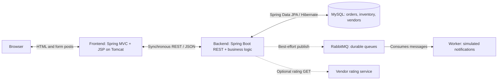
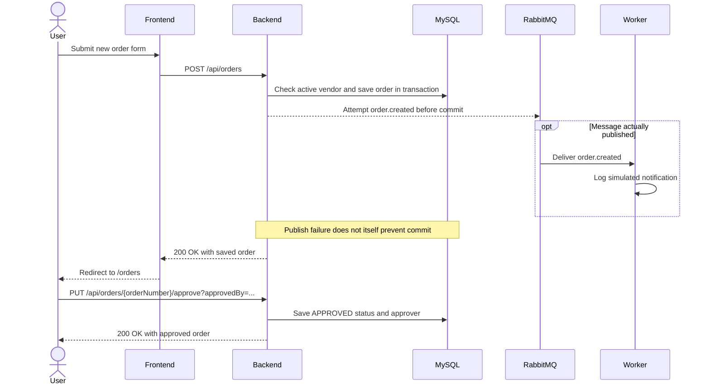

# SupplyChain: architecture and typical workflow

## Executive summary

SupplyChain is a three-service, Java 8 / Spring Boot 2.7.18 application: the frontend renders JSP pages and calls the backend over HTTP, the backend owns purchase-order logic and MySQL persistence, and a separate RabbitMQ worker simulates notifications.[^architecture][^frontend-build][^backend-build][^worker-build][^worker-listener] The normal path is to create an order in the UI, find it in the pending list, and approve it through the backend API; the UI displays an Approve link but has no corresponding handler, and the reviewed code does not implement order receipt or inventory updates from orders.[^new-ui][^order-ui][^approve-ui][^order-api][^order-approval][^inventory-api] Creating an order attempts to publish `order.created`, but that attempt is not atomic with persistence; with the pinned converter and dependencies, the saved order's timestamps are expected to prevent AMQP serialization.[^order-create][^order-model][^amqp-config][^amqp-version][^amqp-mapper][^jackson-unsupported]

## Architecture overview

The frontend-to-backend call is synchronous and server-side. The worker is off the HTTP path: a browser success means the backend returned the order, not that a notification was delivered. The vendor rating lookup is a separate backend route, not part of order creation.[^architecture][^frontend-client][^order-api][^order-create][^vendor-rating]



Diagram evidence: system topology, REST client, persistence setup, and the broker configuration and handlers.[^architecture][^frontend-client][^backend-settings][^order-repo][^amqp-config][^worker-listener][^vendor-rating]

### Key repositories and revisions

| Repository | Reviewed revision | Role |
| --- | --- | --- |
| [luxu-ms/SupplyChain-Backend](https://github.com/luxu-ms/SupplyChain-Backend) | `a21f57e84901bad3cf315de2a3520fa8fe34b911` | REST API, business rules, database, RabbitMQ producer.[^snapshot][^order-api][^order-create] |
| [luxu-ms/SupplyChain-Frontend](https://github.com/luxu-ms/SupplyChain-Frontend) | `c613adbc961e0499d8f2ddb3e087ade7a9a40881` | Server-rendered web UI and backend HTTP client.[^snapshot][^frontend-build][^frontend-client] |
| [luxu-ms/SupplyChain-Worker](https://github.com/luxu-ms/SupplyChain-Worker) | `458f2bab94b08b3acd167feb04fc485a7ecf6133` | RabbitMQ consumers and simulated notifications.[^snapshot][^worker-listener] |
| [luxu-ms/SupplyChain-Docs](https://github.com/luxu-ms/SupplyChain-Docs) | `c12fb6bab374e5042372ecdda94cbd5892b12431` | Source-snapshot topology and local smoke workflow, not a deployment record.[^snapshot][^smoke] |

## Frontend: pages, forms, and the REST client

The frontend is Spring MVC and JSP, not a client-side SPA. Maven builds a WAR, the Docker image deploys it as Tomcat's `ROOT.war`, and Spring resolves views under `/WEB-INF/jsp/`. `GET /` renders dashboard counts fetched from the backend; if any of those calls fails, all four counts are set to zero. The navigation includes orders, pending orders, inventory, and vendors; the last two are read-only views.[^frontend-build][^frontend-docker][^frontend-settings][^dashboard][^navigation][^inventory-ui][^vendor-ui]

`GET /orders/new` renders a form that posts to frontend `POST /orders`. The complete form field list is `orderNumber` (`String`), `vendorId` (`Long`), `totalAmount` (`BigDecimal`), `requestedBy` (`String`), and optional `description` (`String`). Vendor choices are hardcoded as IDs 1 through 4, not populated from the vendor API. The controller binds the form to a DTO, sends it to the backend, then redirects to `/orders` on success or redisplays the form with an error on a service exception.[^new-ui][^order-dto][^order-ui]

The complete frontend client method shows where the browser form becomes a server-to-server request. With the default base URL, this posts JSON to `http://backend:8080/api/orders`.[^frontend-client][^frontend-settings]

```java
public PurchaseOrderDTO createOrder(PurchaseOrderDTO order) {
    String url = backendApiUrl + "/orders";
    log.debug("Calling backend API: POST {}", url);

    return restTemplate.postForObject(url, order, PurchaseOrderDTO.class);
}
```

## Backend: APIs, data, and business rules

The backend is a Spring Boot JAR. Controllers delegate to services, which use Spring Data JPA repositories. MySQL is the configured database; Hibernate updates the schema but does not seed it.[^backend-docker][^order-api][^order-create][^order-repo][^backend-settings][^smoke]

| Area | Implemented HTTP surface |
| --- | --- |
| Orders | `GET /api/orders`, `GET /api/orders/{orderNumber}`, `GET /api/orders/pending`, `POST /api/orders`, and `PUT /api/orders/{orderNumber}/approve?approvedBy=...`. Create and approve return `200 OK` with the order.[^order-api] |
| Inventory | `GET /api/inventory`, `GET /api/inventory/{sku}`, and `GET /api/inventory/low-stock`. Low stock means `quantity <= safetyStock`; the GET does not send alerts.[^inventory-api][^inventory-model][^inventory-service] |
| Vendors | `GET /api/vendors`, `GET /api/vendors/{vendorCode}`, and `GET /api/vendors/{vendorCode}/rating`. The rating route calls a separate HTTP service and falls back to `0.0` on null or error. The UI lists vendor records, and order validation checks active status, not this rating.[^vendor-api][^vendor-rating][^vendor-ui][^order-create] |

**Order data.** `purchase_orders` holds an identity ID, unique order number, scalar vendor ID, total amount, status, requester and approver, requested and approved dates, description, and creation/update timestamps. It has no SKU, quantity, line items, or JPA vendor relationship. The entity defaults a null status to `PENDING` on insert; the create endpoint accepts the entity directly and does not override an explicitly supplied status. The enum is broader than the implemented workflow:[^order-model][^order-api][^order-create][^order-approval]

```java
public enum OrderStatus {
    PENDING,
    APPROVED,
    REJECTED,
    COMPLETED,
    CANCELLED
}
```

**Create and approve.** Create rejects nonpositive amounts and missing or inactive vendors, saves the entity, then attempts to publish it while still inside the database transaction. Approval looks up the order by number, requires `PENDING`, sets `APPROVED` plus approver and approval time, and saves. Approval publishes no event and does not adjust inventory. There is no receive endpoint in the reviewed controllers.[^order-create][^vendor-rating][^order-approval][^order-api][^inventory-api]

## Worker: event contracts and delivery limits

The worker is a separate Spring Boot AMQP JAR. It starts three `String` listeners, each logging the message, sleeping to simulate work, and logging simulated success. It does not send actual email or call a procurement or approval service. Scheduling is enabled at startup, but no scheduled task was found in the reviewed worker tree.[^worker-build][^worker-start][^worker-listener]

Both services configure the same queue names. The backend declares durable queues and uses the default exchange, with the queue name as the routing key. The producer passes full entity objects to a Jackson JSON converter rather than using dedicated event DTOs.[^amqp-config][^worker-settings][^order-create][^inventory-service]

| Queue | Backend behavior | Worker behavior |
| --- | --- | --- |
| `order.created` | Attempts to send the saved `PurchaseOrder` after create. Its fields are those listed above, including lifecycle timestamps.[^order-create][^order-model] | Reads a string, waits 1,000 ms, and logs simulated order notification.[^worker-listener] |
| `inventory.alert` | A helper attempts one send per item with `quantity <= safetyStock`; no caller or scheduler was found in the pinned backend. The intended `Inventory` payload has `id`, `sku`, `productName`, `quantity`, `safetyStock`, `warehouseLocation`, `batchNumber`, and `lastUpdated`; the `isLowStock()` getter also exposes `lowStock` to Jackson.[^inventory-service][^inventory-model][^inventory-api] | Reads a string, waits 500 ms, and logs simulated inventory alert.[^worker-listener] |
| `approval.pending` | Declared but no producer was found, despite the backend README describing this event. The approve route only changes the database state.[^amqp-config][^order-approval][^readme-events] | Reads a string, waits 800 ms, and logs simulated approval notification.[^worker-listener] |

**Why a saved order may never reach the worker.** The backend configures `new Jackson2JsonMessageConverter()`. In Spring AMQP 2.4.17, managed by Spring Boot 2.7.18, this converter creates a plain mapper without registering Java-time support. A normal persisted order has non-null `LocalDateTime` timestamps, so conversion is expected to fail before send under the pinned dependencies. The same issue would apply to a persisted inventory item if its helper were called.[^amqp-config][^amqp-version][^amqp-mapper][^jackson-unsupported][^order-model][^inventory-model] Independently of that issue, publishing is attempted before database commit and send errors are logged and swallowed. No transactional outbox, explicit publisher confirms, retry, or dead-letter configuration is shown in the reviewed application settings; deployed broker policies and runtime overrides were not reviewed.[^order-create][^inventory-service][^amqp-config][^backend-broker][^worker-settings]

## Typical workflow and local smoke check

1. **Bring up dependencies.** Provision MySQL and RabbitMQ, then start the backend. Source defaults are backend port `8080`, MySQL at `mysql:3306/supplychain`, and RabbitMQ at `rabbitmq:5672`. Start the worker against the same broker and queue names. For the frontend, point `BACKEND_API_URL` at the backend API and verify the actual Tomcat connector/port mapping instead of assuming that the configured Spring port `8081` controls an external Tomcat container.[^backend-settings][^backend-broker][^worker-settings][^frontend-settings][^frontend-env][^frontend-docker][^smoke]
2. **Create and check pending.** Provision an active test vendor first; for the UI, its ID must match a hardcoded choice (1 through 4). At `/orders/new`, submit a unique order number, the vendor ID, a positive amount, and a requester. Check `/orders` and `/orders/pending`. Separately check backend publish logs and then worker logs: appearance in the lists is evidence of persistence, not message delivery.[^new-ui][^order-ui][^order-model][^order-create][^vendor-rating][^smoke]
3. **Approve through REST.** Call `PUT /api/orders/{orderNumber}/approve?approvedBy=...`; confirm the order detail is `APPROVED` and it no longer appears in the pending list. The pending JSP instead links to `GET /orders/{orderNumber}/approve`, which has no matching frontend handler. No receiving step follows in the reviewed implementation.[^approve-ui][^order-ui][^order-api][^order-approval][^inventory-api][^smoke]



Sequence evidence: frontend form handler and client, backend order controller and service, and worker listener.[^order-ui][^frontend-client][^order-api][^order-create][^order-approval][^worker-listener]

## Confidence assessment

**High for pinned source behavior.** The service boundaries, HTTP mappings, status transition, event publish sites and consumer logic come from implementation files at the revisions linked above. I treated `supplaychain-backend` as a spelling variant of the backend explicitly identified in the docs. Code search reported the pinned backend and frontend SHAs and the docs semantic index reported the pinned docs SHA; direct reads established source evidence including the worker snapshot.[^snapshot][^order-api][^order-create][^order-approval][^frontend-client][^worker-listener]

**High for the static serialization diagnosis, unverified in a running deployment.** It depends on the pinned dependency versions, the checked-in converter configuration, and non-null timestamps. No live services were started. The docs describe a local smoke check, not production state; environment overrides, broker policy, and externally supplied publishers could change observed behavior.[^snapshot][^smoke][^amqp-config][^amqp-version][^amqp-mapper][^jackson-unsupported][^order-model]

## Footnotes

[^architecture]: [SupplyChain-Docs/architecture.md:3-23](https://github.com/luxu-ms/SupplyChain-Docs/blob/c12fb6bab374e5042372ecdda94cbd5892b12431/architecture.md#L3-L23).
[^snapshot]: [SupplyChain-Docs/architecture.md:37-44](https://github.com/luxu-ms/SupplyChain-Docs/blob/c12fb6bab374e5042372ecdda94cbd5892b12431/architecture.md#L37-L44).
[^smoke]: [SupplyChain-Docs/workflow.md:16-31](https://github.com/luxu-ms/SupplyChain-Docs/blob/c12fb6bab374e5042372ecdda94cbd5892b12431/workflow.md#L16-L31).
[^frontend-build]: [SupplyChain-Frontend/pom.xml:8-55](https://github.com/luxu-ms/SupplyChain-Frontend/blob/c613adbc961e0499d8f2ddb3e087ade7a9a40881/pom.xml#L8-L55).
[^frontend-docker]: [SupplyChain-Frontend/Dockerfile:2-22](https://github.com/luxu-ms/SupplyChain-Frontend/blob/c613adbc961e0499d8f2ddb3e087ade7a9a40881/Dockerfile#L2-L22).
[^frontend-settings]: [SupplyChain-Frontend/src/main/resources/application.yml:1-18](https://github.com/luxu-ms/SupplyChain-Frontend/blob/c613adbc961e0499d8f2ddb3e087ade7a9a40881/src/main/resources/application.yml#L1-L18).
[^frontend-env]: [SupplyChain-Frontend/README.md:14-20](https://github.com/luxu-ms/SupplyChain-Frontend/blob/c613adbc961e0499d8f2ddb3e087ade7a9a40881/README.md#L14-L20).
[^dashboard]: [SupplyChain-Frontend/src/main/java/com/acme/scm/frontend/controller/HomeController.java:30-62](https://github.com/luxu-ms/SupplyChain-Frontend/blob/c613adbc961e0499d8f2ddb3e087ade7a9a40881/src/main/java/com/acme/scm/frontend/controller/HomeController.java#L30-L62).
[^navigation]: [SupplyChain-Frontend/src/main/webapp/WEB-INF/jsp/home.jsp:173-180](https://github.com/luxu-ms/SupplyChain-Frontend/blob/c613adbc961e0499d8f2ddb3e087ade7a9a40881/src/main/webapp/WEB-INF/jsp/home.jsp#L173-L180).
[^new-ui]: [SupplyChain-Frontend/src/main/webapp/WEB-INF/jsp/orders/new.jsp:58-101](https://github.com/luxu-ms/SupplyChain-Frontend/blob/c613adbc961e0499d8f2ddb3e087ade7a9a40881/src/main/webapp/WEB-INF/jsp/orders/new.jsp#L58-L101).
[^order-dto]: [SupplyChain-Frontend/src/main/java/com/acme/scm/frontend/dto/PurchaseOrderDTO.java:8-20](https://github.com/luxu-ms/SupplyChain-Frontend/blob/c613adbc961e0499d8f2ddb3e087ade7a9a40881/src/main/java/com/acme/scm/frontend/dto/PurchaseOrderDTO.java#L8-L20).
[^order-ui]: [SupplyChain-Frontend/src/main/java/com/acme/scm/frontend/controller/OrderController.java:21-71](https://github.com/luxu-ms/SupplyChain-Frontend/blob/c613adbc961e0499d8f2ddb3e087ade7a9a40881/src/main/java/com/acme/scm/frontend/controller/OrderController.java#L21-L71).
[^approve-ui]: [SupplyChain-Frontend/src/main/webapp/WEB-INF/jsp/orders/pending.jsp:74-85](https://github.com/luxu-ms/SupplyChain-Frontend/blob/c613adbc961e0499d8f2ddb3e087ade7a9a40881/src/main/webapp/WEB-INF/jsp/orders/pending.jsp#L74-L85).
[^frontend-client]: [SupplyChain-Frontend/src/main/java/com/acme/scm/frontend/service/BackendApiService.java:29-66](https://github.com/luxu-ms/SupplyChain-Frontend/blob/c613adbc961e0499d8f2ddb3e087ade7a9a40881/src/main/java/com/acme/scm/frontend/service/BackendApiService.java#L29-L66).
[^inventory-ui]: [SupplyChain-Frontend/src/main/java/com/acme/scm/frontend/controller/InventoryController.java:19-31](https://github.com/luxu-ms/SupplyChain-Frontend/blob/c613adbc961e0499d8f2ddb3e087ade7a9a40881/src/main/java/com/acme/scm/frontend/controller/InventoryController.java#L19-L31).
[^vendor-ui]: [SupplyChain-Frontend/src/main/java/com/acme/scm/frontend/controller/VendorController.java:19-30](https://github.com/luxu-ms/SupplyChain-Frontend/blob/c613adbc961e0499d8f2ddb3e087ade7a9a40881/src/main/java/com/acme/scm/frontend/controller/VendorController.java#L19-L30); [SupplyChain-Frontend/src/main/java/com/acme/scm/frontend/service/VendorApiService.java:24-33](https://github.com/luxu-ms/SupplyChain-Frontend/blob/c613adbc961e0499d8f2ddb3e087ade7a9a40881/src/main/java/com/acme/scm/frontend/service/VendorApiService.java#L24-L33).
[^backend-build]: [SupplyChain-Backend/pom.xml:16-27](https://github.com/luxu-ms/SupplyChain-Backend/blob/a21f57e84901bad3cf315de2a3520fa8fe34b911/pom.xml#L16-L27).
[^backend-docker]: [SupplyChain-Backend/Dockerfile:6-24](https://github.com/luxu-ms/SupplyChain-Backend/blob/a21f57e84901bad3cf315de2a3520fa8fe34b911/Dockerfile#L6-L24).
[^backend-settings]: [SupplyChain-Backend/src/main/resources/application.yml:1-23](https://github.com/luxu-ms/SupplyChain-Backend/blob/a21f57e84901bad3cf315de2a3520fa8fe34b911/src/main/resources/application.yml#L1-L23).
[^backend-broker]: [SupplyChain-Backend/src/main/resources/application.yml:25-39](https://github.com/luxu-ms/SupplyChain-Backend/blob/a21f57e84901bad3cf315de2a3520fa8fe34b911/src/main/resources/application.yml#L25-L39).
[^order-api]: [SupplyChain-Backend/src/main/java/com/acme/scm/controller/PurchaseOrderController.java:18-57](https://github.com/luxu-ms/SupplyChain-Backend/blob/a21f57e84901bad3cf315de2a3520fa8fe34b911/src/main/java/com/acme/scm/controller/PurchaseOrderController.java#L18-L57).
[^order-create]: [SupplyChain-Backend/src/main/java/com/acme/scm/service/PurchaseOrderService.java:36-62](https://github.com/luxu-ms/SupplyChain-Backend/blob/a21f57e84901bad3cf315de2a3520fa8fe34b911/src/main/java/com/acme/scm/service/PurchaseOrderService.java#L36-L62).
[^order-approval]: [SupplyChain-Backend/src/main/java/com/acme/scm/service/PurchaseOrderService.java:68-91](https://github.com/luxu-ms/SupplyChain-Backend/blob/a21f57e84901bad3cf315de2a3520fa8fe34b911/src/main/java/com/acme/scm/service/PurchaseOrderService.java#L68-L91).
[^order-model]: [SupplyChain-Backend/src/main/java/com/acme/scm/model/PurchaseOrder.java:14-76](https://github.com/luxu-ms/SupplyChain-Backend/blob/a21f57e84901bad3cf315de2a3520fa8fe34b911/src/main/java/com/acme/scm/model/PurchaseOrder.java#L14-L76).
[^order-repo]: [SupplyChain-Backend/src/main/java/com/acme/scm/repository/PurchaseOrderRepository.java:10-19](https://github.com/luxu-ms/SupplyChain-Backend/blob/a21f57e84901bad3cf315de2a3520fa8fe34b911/src/main/java/com/acme/scm/repository/PurchaseOrderRepository.java#L10-L19).
[^inventory-api]: [SupplyChain-Backend/src/main/java/com/acme/scm/controller/InventoryController.java:13-36](https://github.com/luxu-ms/SupplyChain-Backend/blob/a21f57e84901bad3cf315de2a3520fa8fe34b911/src/main/java/com/acme/scm/controller/InventoryController.java#L13-L36).
[^inventory-model]: [SupplyChain-Backend/src/main/java/com/acme/scm/model/Inventory.java:10-50](https://github.com/luxu-ms/SupplyChain-Backend/blob/a21f57e84901bad3cf315de2a3520fa8fe34b911/src/main/java/com/acme/scm/model/Inventory.java#L10-L50).
[^inventory-service]: [SupplyChain-Backend/src/main/java/com/acme/scm/service/InventoryService.java:41-63](https://github.com/luxu-ms/SupplyChain-Backend/blob/a21f57e84901bad3cf315de2a3520fa8fe34b911/src/main/java/com/acme/scm/service/InventoryService.java#L41-L63).
[^vendor-api]: [SupplyChain-Backend/src/main/java/com/acme/scm/controller/VendorController.java:13-36](https://github.com/luxu-ms/SupplyChain-Backend/blob/a21f57e84901bad3cf315de2a3520fa8fe34b911/src/main/java/com/acme/scm/controller/VendorController.java#L13-L36).
[^vendor-rating]: [SupplyChain-Backend/src/main/java/com/acme/scm/service/VendorService.java:36-57](https://github.com/luxu-ms/SupplyChain-Backend/blob/a21f57e84901bad3cf315de2a3520fa8fe34b911/src/main/java/com/acme/scm/service/VendorService.java#L36-L57).
[^amqp-config]: [SupplyChain-Backend/src/main/java/com/acme/scm/config/AppConfig.java:20-27](https://github.com/luxu-ms/SupplyChain-Backend/blob/a21f57e84901bad3cf315de2a3520fa8fe34b911/src/main/java/com/acme/scm/config/AppConfig.java#L20-L27), [lines 43-68](https://github.com/luxu-ms/SupplyChain-Backend/blob/a21f57e84901bad3cf315de2a3520fa8fe34b911/src/main/java/com/acme/scm/config/AppConfig.java#L43-L68).
[^readme-events]: [SupplyChain-Backend/README.md:226-231](https://github.com/luxu-ms/SupplyChain-Backend/blob/a21f57e84901bad3cf315de2a3520fa8fe34b911/README.md#L226-L231).
[^worker-build]: [SupplyChain-Worker/pom.xml:8-40](https://github.com/luxu-ms/SupplyChain-Worker/blob/458f2bab94b08b3acd167feb04fc485a7ecf6133/pom.xml#L8-L40); [SupplyChain-Worker/Dockerfile:2-18](https://github.com/luxu-ms/SupplyChain-Worker/blob/458f2bab94b08b3acd167feb04fc485a7ecf6133/Dockerfile#L2-L18).
[^worker-start]: [SupplyChain-Worker/src/main/java/com/acme/scm/worker/SupplyChainWorkerApplication.java:16-25](https://github.com/luxu-ms/SupplyChain-Worker/blob/458f2bab94b08b3acd167feb04fc485a7ecf6133/src/main/java/com/acme/scm/worker/SupplyChainWorkerApplication.java#L16-L25).
[^worker-settings]: [SupplyChain-Worker/src/main/resources/application.yml:8-21](https://github.com/luxu-ms/SupplyChain-Worker/blob/458f2bab94b08b3acd167feb04fc485a7ecf6133/src/main/resources/application.yml#L8-L21).
[^worker-listener]: [SupplyChain-Worker/src/main/java/com/acme/scm/worker/listener/OrderMessageListener.java:16-57](https://github.com/luxu-ms/SupplyChain-Worker/blob/458f2bab94b08b3acd167feb04fc485a7ecf6133/src/main/java/com/acme/scm/worker/listener/OrderMessageListener.java#L16-L57).
[^amqp-version]: [spring-boot v2.7.18/spring-boot-project/spring-boot-dependencies/build.gradle:1713-1725](https://github.com/spring-projects/spring-boot/blob/v2.7.18/spring-boot-project/spring-boot-dependencies/build.gradle#L1713-L1725); [spring-boot v2.7.18/gradle.properties:10](https://github.com/spring-projects/spring-boot/blob/v2.7.18/gradle.properties#L10).
[^amqp-mapper]: [spring-amqp v2.4.17/spring-amqp/src/main/java/org/springframework/amqp/support/converter/Jackson2JsonMessageConverter.java:45-60](https://github.com/spring-projects/spring-amqp/blob/v2.4.17/spring-amqp/src/main/java/org/springframework/amqp/support/converter/Jackson2JsonMessageConverter.java#L45-L60).
[^jackson-unsupported]: [jackson-databind 2.13.5/src/main/java/com/fasterxml/jackson/databind/ObjectMapper.java:637-678](https://github.com/FasterXML/jackson-databind/blob/jackson-databind-2.13.5/src/main/java/com/fasterxml/jackson/databind/ObjectMapper.java#L637-L678); [jackson-databind 2.13.5/src/main/java/com/fasterxml/jackson/databind/util/BeanUtil.java:297-316](https://github.com/FasterXML/jackson-databind/blob/jackson-databind-2.13.5/src/main/java/com/fasterxml/jackson/databind/util/BeanUtil.java#L297-L316).
